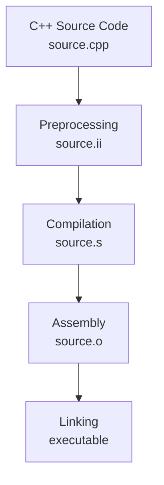
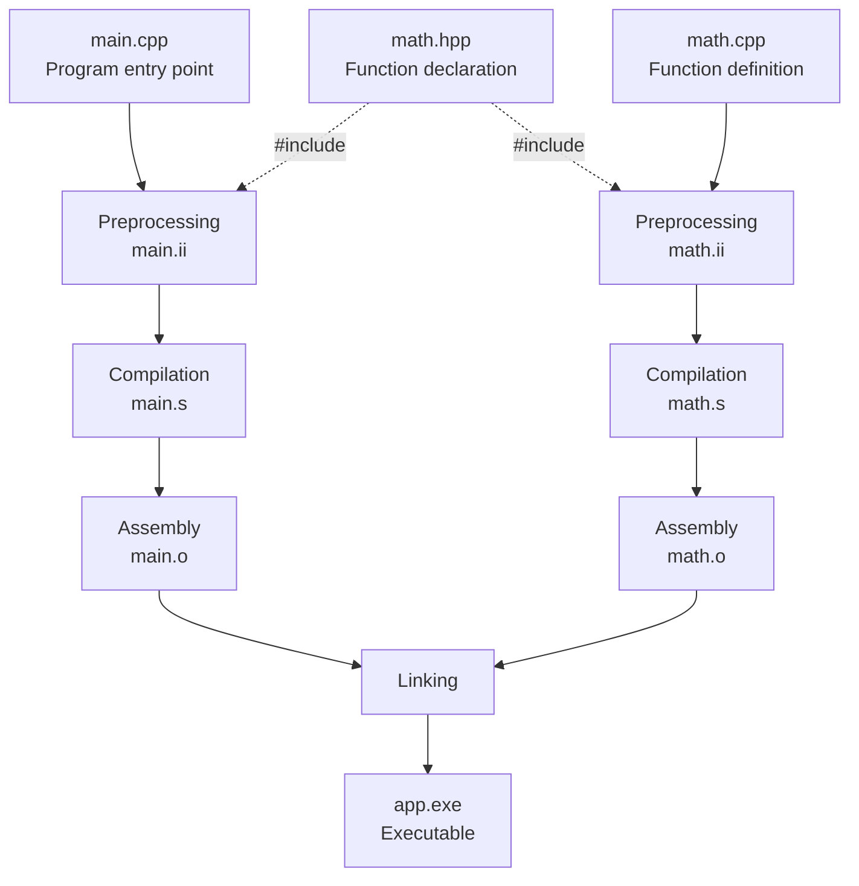

# C++ Compilation Notes

This note explains how C++ source files are transformed into an executable using the GNU C++ compiler driver (`g++`). It introduces the main compilation stages, demonstrates separate compilation and linking, and summarizes useful GCC command-line options.

## Compilation Workflow

The overall compilation and linking process for a single C++ source file is illustrated in [Figure 1](#fig-cpp-compilation-workflow). The diagram shows the logical stages; intermediate files are not necessarily stored during a normal build.

<a id="fig-cpp-compilation-workflow"></a>



**Figure 1. General C++ Compilation and Linking Workflow**

The individual stages are summarized in [Table 1](#tbl-compilation-stages).

<a id="tbl-compilation-stages"></a>

**Table 1. Compilation Stages**

| Stage | Input | Output | Description |
|---|---|---|---|
| Preprocessing | `.cpp` and included headers | `.ii` | Processes preprocessor directives, expands macros, and includes header content. |
| Compilation | `.ii` | `.s` | Analyzes C++ source code and generates target-specific assembly code. |
| Assembly | `.s` | `.o` | Converts assembly instructions into a relocatable object file. |
| Linking | `.o` files and libraries | Executable | Resolves symbol references and combines the required code and data. |

> **Note:** Figure 1 illustrates the logical stages of compiling one source file and linking its object code with any required libraries. Intermediate files are not normally preserved when G++ builds an executable in a single command. On Windows, executables commonly use the `.exe` extension.

### Example Project

The following example uses three files:

```text

cpp-compilation/

├── main.cpp    # Program entry point

├── math.hpp    # Function declaration

└── math.cpp    # Function definition

```

`main.cpp` calls `add(3, 5)`, a function declared in `math.hpp` and defined in `math.cpp`. The program prints the result. The function's implementation is intentionally simple so that the focus remains on compilation and linking.

**`math.hpp`**

```cpp

#ifndef CPP_COMPILATION_MATH_HPP

#define CPP_COMPILATION_MATH_HPP

/**

 * @brief Adds two integers.

 *

 * @param[in] a The first integer.

 * @param[in] b The second integer.

 *

 * @return The sum of a and b.

 *

 * @warning The caller must ensure that the result is representable

 *          as an int. Signed integer overflow is undefined behavior.

 */

int add(int a, int b);

#endif  // CPP_COMPILATION_MATH_HPP

```

**`math.cpp`**

```cpp

#include "math.hpp"

int add(int a, int b) {

    return a + b;

}

```

**`main.cpp`**

```cpp

#include <iostream>

#include "math.hpp"

int main() {

    const int result = add(3, 5);

    std::cout << "Result of add 3 and 5 together is: "

              << result << '\n';

    return 0;

}

```

### Example Workflow

The example project follows the general stages shown in Figure 1, but its two source files are compiled as separate translation units. This workflow is illustrated in [Figure 2](#fig-cpp-example-workflow).

<a id="fig-cpp-example-workflow"></a>



**Figure 2. Compilation and Linking of Separate Translation Units**

The dashed arrows represent header inclusion during preprocessing. The header provides declarations to both translation units but is not compiled independently; `math.o` is produced from `math.cpp`.

### Understanding the Compilation Stages

The compilation workflow consists of four main stages. Each stage transforms its input into a representation suitable for the next stage.

#### 1. Preprocessing
Preprocessing handles preprocessor directives before the main compilation stage.

Its main responsibilities include:

- **Header inclusion (`#include`):** Inserts the contents of the specified header file into the source code, conceptually similar to copying and pasting its contents.

- **Macro expansion (`#define`):** Macros defined with #define are expanded where they are used.

- **Conditional compilation (`#if`, `#ifdef`, `#ifndef`):** Determines which portions of the source code are included based on preprocessor conditions.

In this example, both `main.cpp` and `math.cpp` include `math.hpp`. During preprocessing, the contents of `math.hpp` are included in each source file.

The include guard prevents the header's contents from being included more than once within the same translation unit.

The resulting preprocessed source code can be saved as a `.ii` file. It remains human-readable text, but may be significantly larger than the original source file due to header inclusion and macro expansion.

#### 2. Compilation
Compilation translates preprocessed C++ source code into target-specific assembly code.

Its responsibilities include:

- Performing lexical, syntactic, and semantic analysis.

- Checking language rules and types.

- Producing intermediate representations and performing optimizations as enabled.

- Generating assembly instructions for the target instruction set architecture (ISA).

The output can be saved as an assembly source file (`.s`). Assembly code is generally human-readable, although its instructions depend on the target architecture.

#### 3. Assembly
Assembly converts assembly instructions into machine code and packages them into an object file.

An object file typically contains:

- Machine code and data.

- Symbol information, including defined and referenced symbols.

- Relocation information for references whose final locations are not yet determined.

- Debugging information, when requested and supported.

The output is generally a relocatable object file (`.o`). It is not normally a standalone executable because references to code or data in other translation units may still need to be resolved.

#### 4. Linking
`main.cpp` and `math.cpp` are compiled as separate translation units.

The declaration of `add()` in `math.hpp` allows `main.cpp` to compile a call even though the definition is in `math.cpp`. During linking, the linker resolves the reference in `main.o` using the definition in `math.o`.

Its responsibilities include:

- Resolving symbol references between object files and libraries. A library provides reusable code, allowing developers to use existing functionality without implementing it from scratch.

- Applying relocations to adjust address-dependent references after object-file sections are placed in the output.

- Producing the executable and its required binary structure and library dependencies.

The output is an executable file, such as `app.exe` on Windows. Depending on the build configuration, the program may use statically linked code and/or shared libraries.

If `math.o` is omitted, the link step fails because the definition of `add()` cannot be found. Conversely, multiple definitions of the same externally linked function or variable may cause a multiple-definition error. Merely using the same local variable name in different source files is not a linking error.

### Compiling Step by Step

The following commands reproduce the stages for the two translation units shown in Figure 2. **Each stage uses the files generated by the preceding stage**, rather than starting again from the original `.cpp` files.

Run these commands from the directory containing `main.cpp`, `math.cpp`, and `math.hpp`.

> **Note:** By default, G++ processes C++ source files through all compilation stages, including linking, to produce an executable.

>

> The `-E`, `-S`, and `-c` options control where the compilation process stops, while the input file type determines which stages are required.

>

> - `.cpp`: Starts with preprocessing.

> - `.ii`: Already preprocessed; starts with compilation.

> - `.s`: Already compiled into assembly; starts with assembly.

> - `.o`: Already assembled; used as input for linking.

>

> Therefore, G++ can accept input from an earlier stage and perform only the remaining stages needed to produce the requested output.

**Step 1 — Preprocessing (`.cpp` → `.ii`)**

Use `-E` to stop after preprocessing:

```bash

g++ -std=c++20 -E main.cpp -o main.ii

g++ -std=c++20 -E math.cpp -o math.ii

```

The output files contain the preprocessed C++ translation units, including expanded header contents.

**Step 2 — Compilation (`.ii` → `.s`)**

Use `-S` to generate assembly code without assembling or linking:

```bash

g++ -std=c++20 -Wall -Wextra -Wpedantic -g -O0 -S main.ii -o main.s

g++ -std=c++20 -Wall -Wextra -Wpedantic -g -O0 -S math.ii -o math.s

```

The resulting `.s` files contain target-specific assembly code.

**Step 3 — Assembly (`.s` → `.o`)**

Use `-c` with assembly input to produce object files without linking:

```bash

g++ -c main.s -o main.o

g++ -c math.s -o math.o

```

The resulting `.o` files contain machine code and information required for linking.

**Step 4 — Linking (`.o` → `.exe`)**

Link the object files with G++:

```bash

g++ main.o math.o -o app.exe

```

The linker resolves the call to `add()` and produces `app.exe`, which can then be executed on the target platform.

**Optional linking experiment:** Omit the object file containing the function definition:

```bash

g++ main.o -o app.exe

```

The link should fail with an unresolved reference to `add()` (the exact diagnostic wording varies by toolchain). This demonstrates why a function declaration is not a substitute for its definition at link time.

### Building in a Single Command

G++ can coordinate all four stages automatically:

```bash

g++ -std=c++20 -Wall -Wextra -Wpedantic -g -O0 main.cpp math.cpp -o app.exe

```

Both source files are processed as separate translation units, and their object code is linked with the required libraries. Unlike the step-by-step demonstration, intermediate files are not normally preserved. This command achieves the same program-building goal without manually naming each intermediate file.

### Inspecting the Compilation Process

G++ offers options to inspect the subprocess commands it runs and to keep intermediate files.

**Display executed commands (`-v`):**

```bash

g++ -v -std=c++20 -Wall -Wextra -Wpedantic -g -O0 main.cpp math.cpp -o app.exe

```

Verbose output can show compiler-driver information and invocations of tools such as `cc1plus`, `as`, and `collect2` (which may invoke the linker). It does **not** provide a step-by-step trace of every internal compiler transformation.

**Display planned commands without executing them (`-###`):**

```bash

g++ -### -std=c++20 main.cpp math.cpp -o app.exe

```

This displays the planned subprocess commands without performing compilation or linking.

**Preserve intermediate files (`-save-temps`):**

```bash

g++ -save-temps -std=c++20 main.cpp math.cpp -o app.exe

```

This keeps intermediate files for inspection. For a multi-source link command, GCC may prefix their names with the executable name (for example, `app-main.ii` instead of `main.ii`); the precise naming depends on GCC's auxiliary-output rules and options.

## Compilation Command
The previous examples show how to build the project using G++. The general command syntax is:

```text

g++ [options] <source-file> [additional-source-files...] [-o <output-file>]

```

The compiler driver coordinates the relevant stages. Common command options are summarized in [Table 2](#tbl-command-explanations).

<a id="tbl-command-explanations"></a>

**Table 2. Compiler Command Options**

| Command / Option | Description | Default / Alternatives | Recommendation |
|---|---|---|---|
| `g++` | GNU C++ compiler driver (a command, not an option). | Alternative compiler driver: `clang++`. | Use when building with GCC's C++ toolchain. |
| `-std=c++20` | Selects the C++ language standard. | Default depends on GCC version; alternatives include `c++17` and `c++23`. | Specify explicitly for each project. |
| `-Wall` | Enables a set of commonly useful warnings. | This warning group is not enabled by default. | Recommended. |
| `-Wextra` | Enables additional warnings. | This warning group is not enabled by default. | Recommended. |
| `-Wpedantic` | Requests diagnostics for certain constructs outside the selected ISO standard. | Disabled by default; related option: `-pedantic-errors`. | Recommended for standards-oriented code. |
| `-g` | Generates debugging information. | Disabled by default; levels include `-g0`, `-g1`, `-g2`, `-g3`. | Recommended for debugging builds. |
| `-O0` | Disables most optimizations. | Default optimization level; alternatives include `-O1`, `-O2`, `-O3`, `-Og`, `-Os`. | Use `-O0` or `-Og` for debugging, as appropriate. |
| `-o <file>` | Sets the primary output filename. | Common default executable names: `a.out` (Unix-like systems) or `a.exe` (MinGW). | Name outputs explicitly. |
| `-E` | Stops after preprocessing and outputs preprocessed source code (`.ii` when saved explicitly). | Not selected by default. | Inspect preprocessed source. |
| `-S` | Stops after compilation and produces assembly code (`.s`). | Not selected by default. | Inspect generated assembly code. |
| `-c` | Compiles or assembles without linking, producing object files (`.o`). | Not selected by default. | Produce object files for separate linking. |
| `-v` | Displays executed subprocess commands and compiler information. | Not selected by default. | Inspect the compilation workflow. |
| `-###` | Displays planned subprocess commands without executing them. | Not selected by default. | Inspect how G++ constructs tool commands. |
| `-save-temps` | Preserves intermediate compilation files. | Temporary intermediates are normally removed. | Examine intermediate files. |

### Compiler Option Details
#### 1. Default C++ Language Standard (`-std`)
The default C++ language standard depends on the GCC version.

| GCC Version | Default C++ Standard |
|---|---|
| GCC 6–10 | `gnu++14` |
| GCC 11–15 | `gnu++17` |
| GCC 16 | `gnu++20` |

**Notes:**

- `gnu++20` enables the GNU dialect of C++20, including GNU extensions.

- `c++20` selects the ISO C++20 language dialect; GCC may still accept extensions that do not conflict with that dialect.

- `-Wpedantic` requests additional diagnostics related to ISO language conformance; it does not by itself prohibit every extension.

- Explicitly specifying `-std=c++20` avoids depending on a particular GCC version's default language dialect.

- The selected language standard and the features used must be supported by the installed compiler and standard library. Future GCC versions may change their defaults.

#### 2. Optimization Levels (`-O`)
GCC provides several optimization levels that trade off compilation time, code size, execution performance, and debugging experience.

When no `-O` level is specified, the default is `-O0`.

| Option | Purpose |
|---|---|
| `-O0` | Disables most optimizations and generally simplifies source-level debugging. |
| `-O1` | Enables basic optimizations. |
| `-O2` | Enables additional optimizations commonly used in optimized builds. |
| `-O3` | Enables more aggressive optimizations. |
| `-Og` | Enables optimizations selected with debugging usability in mind. |
| `-Os` | Optimizes primarily for code size. |

**Notes:**

- `-O0` is useful when examining execution step by step.

- GCC recommends `-Og` as a useful choice for the usual edit–compile–debug cycle.

- `-O2` is commonly used for optimized builds.

- A higher optimization level does not guarantee better performance for every program.

- Optimization may change the availability and apparent order of variables or instructions in a debugger.

#### 3. Debugging Information and Optimization (`-g` and `-O`)
The `-g` and `-O` options control different aspects of compilation:

- `-g` generates debugging information for tools such as GDB.

- `-O` controls the optimization level.

- Both can be used together.

**Example 1: Simple debugging**

```bash

g++ -std=c++20 -Wall -Wextra -Wpedantic -g -O0 main.cpp math.cpp -o app.exe

```

**Example 2: Debugging with optimization**

```bash

g++ -std=c++20 -Wall -Wextra -Wpedantic -g -Og main.cpp math.cpp -o app.exe

```

**Example 3: Optimized build**

```bash

g++ -std=c++20 -Wall -Wextra -Wpedantic -O2 main.cpp math.cpp -o app.exe

```

**Notes:**

- Debugging information can be generated even when optimization is enabled.

- Optimized code may be harder to debug because variables or instructions can be reordered, combined, or eliminated.

- `-Wall` does not enable every compiler warning.

- Some warnings may be enabled by default even without `-Wall`.

### Notes
- Compiler defaults and supported options may vary by GCC version and target platform.

- Explicit compiler options improve clarity and reduce accidental differences between builds, but do not by themselves guarantee fully reproducible binaries.

### References
- [GCC — Invoking GCC](https://gcc.gnu.org/onlinedocs/gcc/Invoking-GCC.html) — Compiler driver and compilation overview.

- [GCC — Options Controlling the Kind of Output](https://gcc.gnu.org/onlinedocs/gcc/Overall-Options.html) — `-E`, `-S`, `-c`, `-v`, `-###`, `-o`, and intermediate filename rules.

- [GCC — Preprocessor Options](https://gcc.gnu.org/onlinedocs/gcc/Preprocessor-Options.html) — Preprocessing behavior and preprocessed input.

- [GCC — Developer Options](https://gcc.gnu.org/onlinedocs/gcc/Developer-Options.html) — `-save-temps` and related options.

- [GCC — C Dialect Options](https://gcc.gnu.org/onlinedocs/gcc/C-Dialect-Options.html) — `-std` and GNU versus ISO language dialects.

- [GCC — C++ Standards Support](https://gcc.gnu.org/projects/cxx-status.html) — Supported language features by GCC version.

- [GCC — Warning Options](https://gcc.gnu.org/onlinedocs/gcc/Warning-Options.html) — `-Wall`, `-Wextra`, `-Wpedantic`.

- [GCC — Debugging Options](https://gcc.gnu.org/onlinedocs/gcc/Debugging-Options.html) — Debugging information options.

- [GCC — Optimization Options](https://gcc.gnu.org/onlinedocs/gcc/Optimize-Options.html) — Optimization levels and their trade-offs.

- [GCC — Link Options](https://gcc.gnu.org/onlinedocs/gcc/Link-Options.html) — Linking object files and libraries.

- [GNU Binutils — LD Overview](https://sourceware.org/binutils/docs/ld/Overview.html) — Symbol resolution and relocation.
