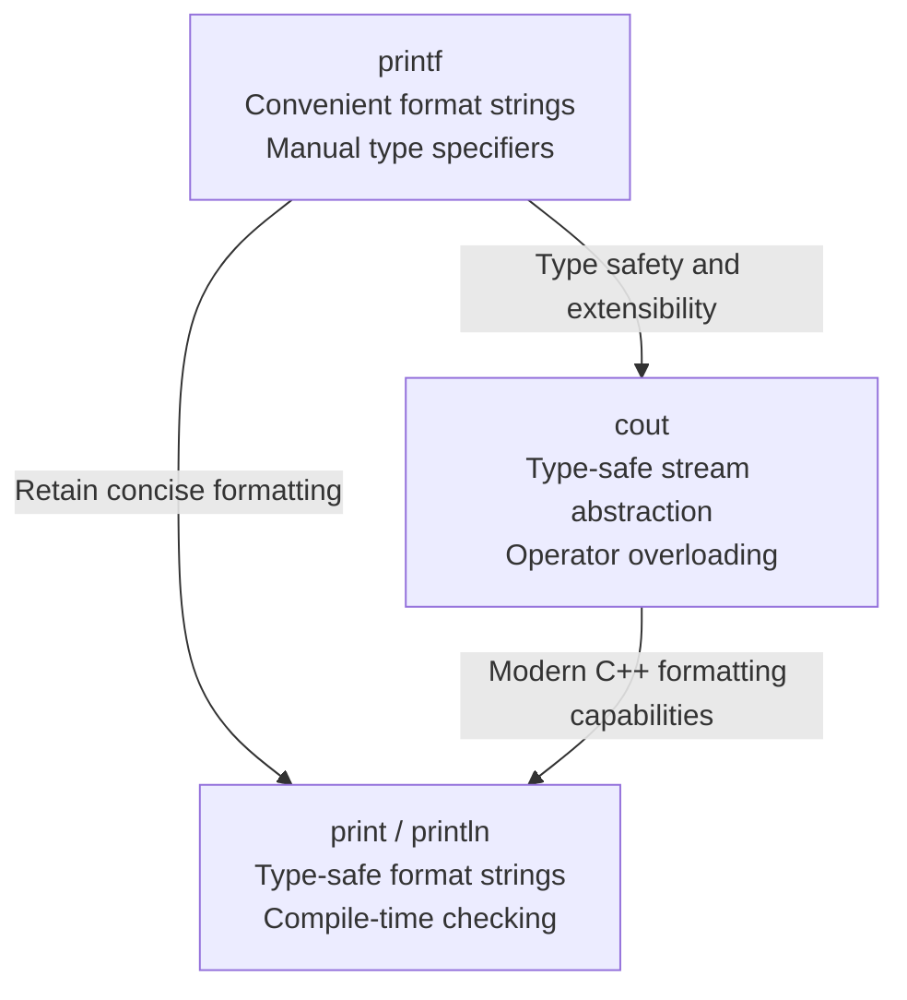

# C++ Standard Output

C++ provides several standard output APIs, including the C-style `printf`, stream-based `cout`, and modern formatted output through `print`.

These APIs reflect different approaches to type safety, extensibility, and text formatting.

## Output APIs and Evolution

### 1. `std::printf` — C-Style Formatted Output

- **Header:** `<cstdio>`
- **Namespace:** `std`
- Inherited from the C standard library.
- Uses format specifiers such as `%d`, `%f`, and `%s`.
- Separates the output format from its arguments.

**Advantages:**

- Concise syntax for formatted text output.
- Widely supported across C and C++ environments.
- Useful for legacy code, C interoperability, and environments without modern C++ library support.

**Limitations:**

- Format specifiers must match argument types; mismatches can cause undefined behavior.
- Uses C-style variadic arguments without the type safety of C++ templates.
- Does not directly support `std::string` or arbitrary user-defined types.
- Using untrusted input as a format string can introduce a **format string vulnerability**, potentially causing memory disclosure, program crashes, or memory modification.

**Notes:**

- Compilers can detect many format mismatches through warnings such as GCC's `-Wformat`.
- Use `.c_str()` when passing a `std::string` to `%s`.
- Use a fixed format string, such as `"%s"`, when printing untrusted text.

### 2. `std::cout` — Type-Safe Stream Output

- **Header:** `<iostream>`
- **Namespace:** `std`
- A standard output stream object belonging to the C++ iostream system.
- Uses the operator `<<` to output values.
- Selects appropriate output operations through operator overloading.

**Advantages:**

- Provides type-safe output through C++ overload resolution.
- Supports user-defined types through overloaded `operator<<`.
- Integrates with the C++ stream system and its state management.
- Supports `std::string` directly.

**Limitations:**

- Chaining many `<<` operators can make complex formatted output harder to read.
- Formatting often requires manipulators such as `std::fixed` and `std::setprecision`.
- Some formatting settings modify persistent stream state and affect subsequent output.
- Use a common std::mutex object or std::osyncstream (C++20) when non-interleaved multithreaded output is required. All participating writers must follow the same synchronization mechanism.

**Notes:**

- Prefer `std::string` for managing text rather than manually handling character buffers.
- When outputting a C-style string (`const char*`), ensure it points to a valid null-terminated string.

### 3. `std::print` / `std::println` — Modern Formatted Output

- **Header:** `<print>`
- **Namespace:** `std`
- **Since:** C++23
- Use `{}` placeholders for formatted output.
- Automatically determine argument types.
- Support compile-time format string validation.
- Writes to stdout by default, and also supports FILE* and std::ostream as output destinations.
- `std::print` does not automatically append a newline.
- `std::println` automatically appends a newline.

**Advantages:**

- Combines the convenience of `printf`-style formatting with modern C++ type safety.
- Uses variadic templates and compile-time format checking.
- Avoids type-specific placeholders such as `%d` and `%s`.
- Supports user-defined types through `std::formatter`.
- Keeps format specifications local without modifying persistent stream formatting state.
- Supports positional arguments and flexible formatting rules.
- Improves Unicode terminal output handling and offers opportunities for better performance.
- Provide non-interleaved output at the function-call level when multiple threads write to the same C stream through synchronized C stream operations.

**Limitations:**

- Requires C++23 and compatible standard library support.
- User-defined types require an appropriate formatter; existing `operator<<` overloads are not automatically reused.
- Does not replace all capabilities of the iostream system.

**Notes:**

- Prefer fixed, compile-time-checked format strings and pass dynamic text as arguments.
- Supports `std::string` directly without `.c_str()`.
- `std::println` does not guarantee an explicit flush.

## Design Evolution



Early C++ introduced iostreams for type-safe and extensible I/O. With modern language features such as variadic templates and compile-time format checking, std::print combines the convenience of format strings with type safety, while remaining compatible with existing output streams.

## Comparison

| Feature | `printf` | `cout` | `print` |
|---|---|---|---|
| Origin | C | C++98 | C++23 |
| Syntax | `%d`, `%s` | `<<` | `{}` |
| Type safety | Limited | Yes | Yes |
| Compile-time format checking | Compiler-dependent diagnostics | Not format-string-based | Yes |
| User-defined types | Not directly | `operator<<` | `std::formatter` |
| Formatting style | Format string | Stream operations | Format string |
| Compatibility | Very broad | Broad | C++23 required |

## Output Buffering and Flushing

**Output Buffering:** Temporarily stores output data in a buffer to reduce the overhead of frequent I/O operations.

**Flushing:** Requests that pending buffered output data be written to the underlying output destination.

The actual buffering behavior depends on the stream configuration, runtime library, and output destination.

**Common operations:**

| Operation | Newline | Explicit Flush |
|---|---|---|
| `'\n'` | Yes | No |
| `std::endl` | Yes | Yes |
| `std::flush` | No | Yes |
| `std::print("...")` | Only if specified | No |
| `std::println("...")` | Yes | No |

**Important notes:**

- A newline may trigger flushing on line-buffered output, especially when connected to a terminal, but this is not guaranteed by `'\n'` itself.
- `std::endl` inserts a newline and explicitly flushes the stream.
- Flushing does not guarantee that data has been physically written to disk.
- Unnecessary flushing can reduce performance.
- Prefer `'\n'` for ordinary line breaks and flush explicitly when immediate output is needed.
- `std::cin` is tied to `std::cout` by default, causing `std::cout` to be flushed before input operations.

## Examples

The following examples compare variable formatting, newline behavior, and multi-line output.


```cpp
#include <cstdio>
#include <iostream>
#include <print>
#include <string>

int main() {
    const std::string name = "Alice";
    const int age = 29;
    const double score = 92.5;

    // 1. C-style formatted output
    std::printf("[printf] Name: {%s}, Age: %d, Progress: 100%%",
                name.c_str(), age);

    // Remaining C++ code...
}
```


**Expected output:**

```text
[printf] Name: {Alice}, Age: 29, Progress: 100%, Score: 92.5
[cout] Name: {Alice}, Age: 29, Progress: 100%, Score: 92.5
[print] Name: {Alice}, Age: 29, Progress: 100%, Score: 92.5
[println] Name: {Alice}, Age: 29, Progress: 100%, Score: 92.5
[Multi-line cout]
Name: Alice
Score: 92.5
[Multi-line println]
Name: Alice
Score: 92.5
```


## References

- [cppreference — std::printf](https://en.cppreference.com/w/cpp/io/c/printf)
- [cppreference — std::cout](https://en.cppreference.com/w/cpp/io/cout)
- [cppreference — std::print](https://en.cppreference.com/w/cpp/io/print)
- [cppreference — std::endl](https://en.cppreference.com/w/cpp/io/manip/endl)
- [cppreference — std::flush](https://en.cppreference.com/w/cpp/io/manip/flush)
- [P2093R14 — Formatted Output](https://www.open-std.org/jtc1/sc22/wg21/docs/papers/2022/p2093r14.html)
- [P0645 — Text Formatting](https://fmt.dev/papers/p0645.html)
- [cppreference — C++ Compiler Support](https://en.cppreference.com/w/cpp/compiler_support)

---

[Back to C++]({{ '/topics/programming-languages/cpp/' | relative_url }})