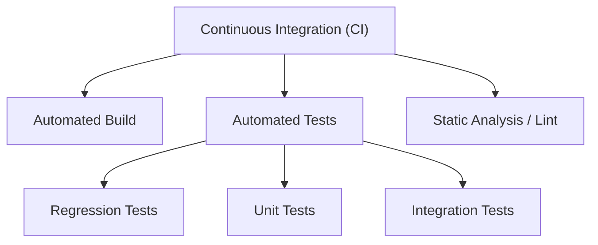
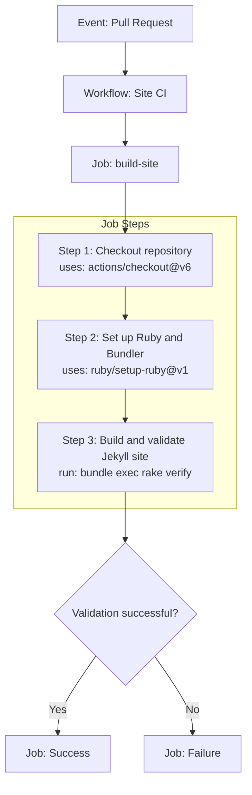
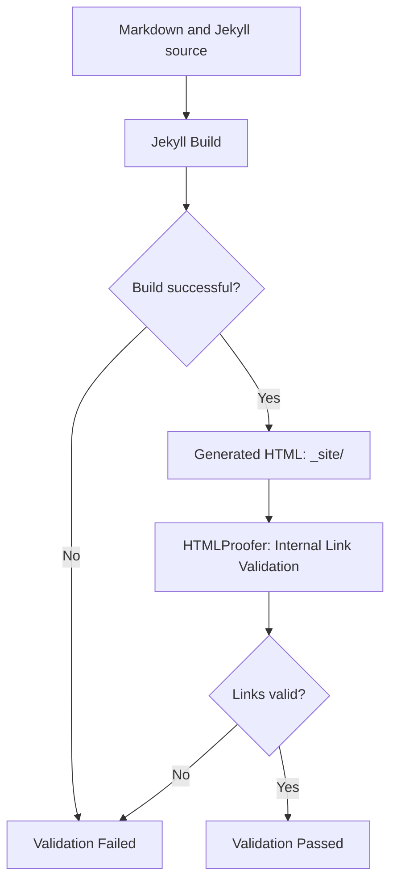
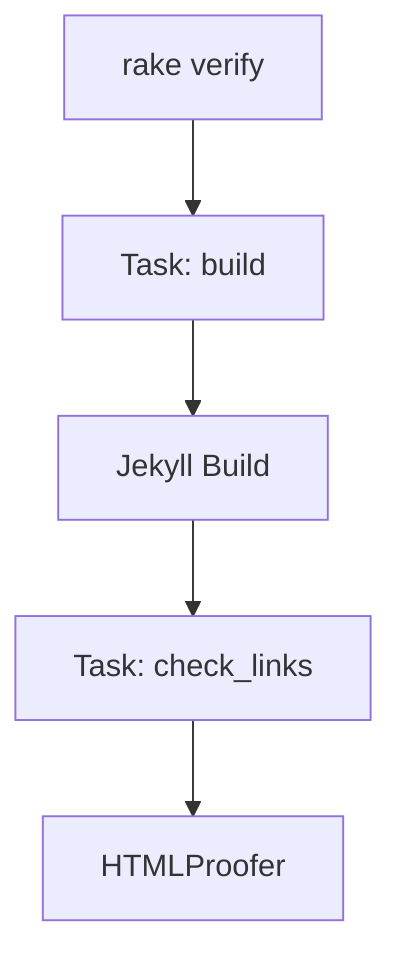
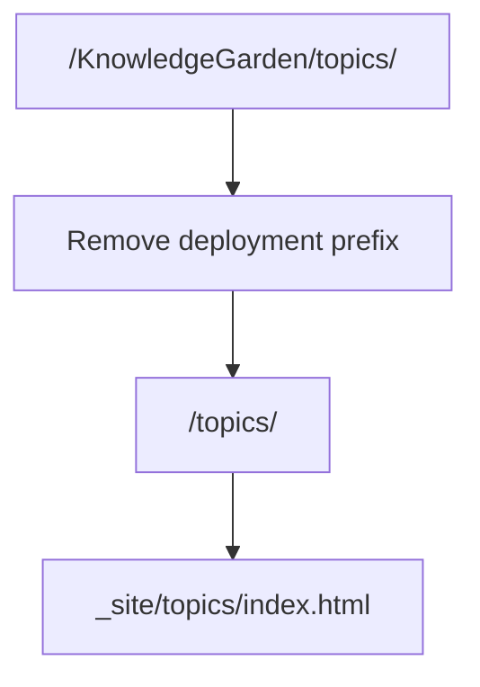

# Continuous Integration (CI) with GitHub Actions

## 1. Overview

### What Is Continuous Integration?

Continuous Integration (CI) is a software development practice in which developers frequently integrate changes into a shared codebase.

Each integration is validated through automated processes, such as builds, tests, and static analysis.

The main objective is to detect integration problems and regressions early, before changes accumulate and become difficult to diagnose.

### Why Is CI Useful?

CI provides several benefits:

- **Early defect detection:** Identify build failures, integration problems, and regressions before changes are merged.
- **Consistent verification:** Execute the same validation procedures without depending entirely on manual operations.
- **Reduced repetitive work:** Automate routine build and testing tasks.
- **Faster feedback:** Help developers identify problems shortly after changes are introduced.
- **Traceability:** Associate verification results and logs with specific commits and Pull Requests.

However, CI cannot guarantee software correctness. Its effectiveness depends on the coverage and reliability of its validation procedures.


### Common CI Checks

A CI pipeline can perform different types of automated checks depending on the project's requirements.



The diagram illustrates common CI activities rather than a mandatory pipeline structure. Not every CI pipeline needs all of these checks.

Regression testing describes a testing purpose, while unit testing and integration testing describe testing levels. These categories can overlap.

#### Automated Build

Automatically builds the project to verify that its source files and dependencies can be processed successfully.

#### Automated Tests

Automatically executes tests to verify expected behavior and detect defects introduced by changes.

Testing strategies depend on the project's requirements and architecture.

#### Regression Tests

Verify that previously working behavior has not been unintentionally broken by subsequent changes.

Regression testing is not a separate testing level. A unit test or an integration test can also serve as a regression test.

#### Unit Tests

Verify individual units of functionality, such as functions, methods, or classes, typically in isolation from external dependencies.

#### Integration Tests

Verify that multiple components work together correctly, such as an application communicating with a database or multiple modules exchanging data.

#### Static Analysis / Lint

Analyze source code and configuration files without executing the program to identify potential bugs, unsafe patterns, and violations of coding rules.

Common examples include:

- `clang-tidy`: C/C++ static analysis.
- `cppcheck`: C/C++ static analysis.
- ESLint: JavaScript and TypeScript linting.
- Markdownlint: Markdown style and consistency checking.

CI does not require every type of check. The appropriate validation strategy depends on the project's architecture, risks, and maintenance requirements.

---

## 2. GitHub Actions Fundamentals

GitHub Actions is an automation platform that can implement CI workflows.

**CI is the development practice, while GitHub Actions is a tool used to implement it.**

GitHub Actions workflows are defined as YAML files in the repository:

```text
.github/workflows/
```

### Core Components

| Component | Description | Example |
|---|---|---|
| Workflow | An automated process consisting of one or more jobs | `Site CI` |
| Event | An activity that triggers a workflow | Opening or updating a Pull Request |
| Job | A collection of steps executed on a runner | `build-site` |
| Step | An individual operation within a job | Checkout repository or execute tests |
| Runner | A machine that executes a job | GitHub-hosted Ubuntu runner |
| Action | A reusable component that performs a defined task | `actions/checkout@v6` |


### Workflow Execution Model



A job consists of steps that execute on the same runner.

Each step can either use a reusable Action (`uses`) or execute a shell command (`run`).

Actions encapsulate reusable functionality, while `run` steps execute commands directly in the runner environment.

A workflow can contain multiple jobs, and each job contains one or more steps.

By default, jobs can run concurrently. Explicit dependencies can be defined using `needs`.

Within a job, steps normally execute sequentially. If a step fails, subsequent steps that use the default success condition are skipped.

### `uses` vs. `run`

GitHub Actions provides two common ways to define steps.

**Use an existing Action:**

```yaml
- name: Checkout repository
  uses: actions/checkout@v6
```

The `uses` keyword references a reusable Action.

In this example, `actions/checkout` retrieves the repository content and makes it available in the runner's workspace.

**Execute a shell command:**

```yaml
- name: Build and validate Jekyll site
  run: bundle exec rake verify
```

The `run` keyword executes a command in the runner environment.

These approaches can be combined within a single workflow.

### Example: Jekyll Site CI Workflow

The following workflow validates a Jekyll website whose source directory is `docs/`.
This workflow performs build and validation checks but does not deploy the website.

```yaml
name: Site CI

# Run when a pull request targets the main branch.
on:
  pull_request:
    branches:
      - main

# Grant only the permissions required by the workflow.
permissions:
  contents: read

jobs:
  build-site:
    runs-on: ubuntu-24.04

    # Apply this working directory to run steps.
    defaults:
      run:
        working-directory: docs

    steps:
      - name: Checkout repository
        uses: actions/checkout@v6

      - name: Set up Ruby and Bundler
        uses: ruby/setup-ruby@v1
        with:
          ruby-version: '3.3'
          bundler-cache: true
          working-directory: docs

      - name: Build and validate Jekyll site
        run: bundle exec rake verify
```

#### Event and Branch Filter

```yaml
on:
  pull_request:
    branches:
      - main
```

The workflow is triggered by Pull Request events targeting `main`.

The branch filter refers to the **base branch**, rather than the source branch of the Pull Request.

By default, the `pull_request` event runs on opening, reopening, or synchronizing a Pull Request. Synchronization includes pushing new commits to the PR branch.

For mergeable Pull Requests, GitHub Actions normally checks out a simulated merge commit. This helps validate how the proposed changes interact with the target branch.

#### Permissions

```yaml
permissions:
  contents: read
```

This limits the workflow's GitHub token to read-only repository content access.

It follows the **principle of least privilege**, reducing unnecessary permissions.

#### Runner

```yaml
runs-on: ubuntu-24.04
```

The job executes on a GitHub-hosted Ubuntu 24.04 runner.

The runner does not need to use the same operating system as the developer's machine, provided the project and its dependencies support the selected environment.

However, cross-platform differences can still affect dependency installation, filesystem behavior, and command execution.

#### Working Directory

```yaml
defaults:
  run:
    working-directory: docs
```

This changes the working directory of steps using `run`.

It does not automatically apply to all reusable Actions.

For example, `ruby/setup-ruby` separately requires:

```yaml
with:
  working-directory: docs
```

This allows Bundler to locate the Jekyll project's `Gemfile`.

#### Ruby and Bundler

```yaml
ruby-version: '3.3'
bundler-cache: true
```

The workflow configures Ruby 3.3 and enables Bundler dependency installation and caching.

The project's `Gemfile` declares dependencies, while `Gemfile.lock` records the resolved dependency versions.

#### Validation Command

```yaml
run: bundle exec rake verify
```

Instead of placing all build and validation commands directly in the workflow, GitHub Actions invokes a developer-defined Rake task that organizes and executes the project's build and validation procedures.

This separates the automation platform from the implementation of the validation procedure.

---

## 3. CI Implementation for a Jekyll Website

### Motivation

A static website can build successfully while still containing broken internal links.

For example, moving or renaming a Markdown document may invalidate links from other pages without preventing Jekyll from generating the website.

Therefore, build validation alone is insufficient.

A basic CI pipeline for a Jekyll documentation website can combine:

1. Jekyll build validation.
2. Internal link validation.

### Validation Pipeline



Jekyll processes the source content and produces HTML files.

HTMLProofer then inspects the generated output and checks whether internal references resolve correctly.

### Using Rake to Organize Validation Tasks

Rake is a Ruby task runner, conceptually similar to Make.

It allows related commands to be defined as named tasks with explicit dependencies.

An example `Rakefile` is:

```ruby
# frozen_string_literal: true

require "html-proofer"

desc "Build the Jekyll website"
task :build do
  sh "bundle exec jekyll build --trace"
end

desc "Validate internal links in the generated website"
task :check_links do
  HTMLProofer.check_directory(
    "./_site",
    checks: ["Links"],
    disable_external: true,
    swap_urls: {
      %r{\A/KnowledgeGarden/} => "/"
    }
  ).run
end

desc "Build the website and validate internal links"
task verify: [:build, :check_links]
```

#### Task Dependencies



The `verify` task depends on both `build` and `check_links`.

Rake executes the prerequisite tasks in order. If an earlier task raises an error, the remaining tasks are not executed normally.

#### Available Commands

The following commands are executed from the Jekyll project directory.

| Command | Purpose |
|---|---|
| `bundle exec rake build` | Generate the website |
| `bundle exec rake check_links` | Validate links in the existing generated HTML |
| `bundle exec rake verify` | Build the website and validate its internal links |
| `bundle exec rake -T` | List documented Rake tasks |

The `check_links` task does not rebuild the website. Therefore, it may inspect stale files if the source has changed.

The `verify` task is preferable for complete validation.

### Why Use Rake?

Rake provides several engineering benefits:

**Separation of concerns**

GitHub Actions handles event triggering, runner management, and reporting.

Rake defines the project's build and validation procedures.

**Reusability**

The same tasks can be executed locally or in CI.

**Maintainability**

A validation procedure can be modified in one place instead of duplicating commands across local scripts and workflow files.

**Extensibility**

New validation tasks can be added independently and included in the `verify` task when needed.

However, sharing a Rakefile does not eliminate operating system differences or guarantee identical environments.

### Jekyll Build Validation

The build task executes:

```bash
bundle exec jekyll build --trace
```

Jekyll transforms Markdown, Liquid templates, layouts, and other source files into static website content.

The generated output is typically stored in:

```text
_site/
```

The `--trace` option provides a detailed error backtrace when Jekyll encounters an exception.

A successful build confirms that the website generation process completed. It does not guarantee that every generated link, visual element, or browser interaction is correct.

### Internal Link Validation with HTMLProofer

HTMLProofer is a tool for validating generated HTML.

In this example, the `Links` check is enabled:

```ruby
checks: ["Links"]
```

This checks internal link destinations, fragment references, and other link-related conditions supported by the validator.

External URL validation is disabled:

```ruby
disable_external: true
```

This keeps the check focused on content controlled by the repository and avoids failures caused by external website availability.

Consequently, broken links to external documentation websites are not detected by this configuration.

### Handling Jekyll's `baseurl`

A GitHub Pages project website may be hosted under a repository-specific URL prefix.

For example:

```text
https://example.github.io/KnowledgeGarden/
```

The Jekyll configuration may contain:

```yaml
baseurl: "/KnowledgeGarden"
```

However, the generated website files do not necessarily contain a corresponding `KnowledgeGarden/` directory.

For example:

```text
Generated URL:
/KnowledgeGarden/topics/

Generated file:
_site/topics/index.html
```

If HTMLProofer interprets the URL without accounting for `baseurl`, it may incorrectly report a valid internal link as broken.

This can be resolved with URL replacement:

```ruby
swap_urls: {
  %r{\A/KnowledgeGarden/} => "/"
}
```

The regular expression matches URLs beginning with `/KnowledgeGarden/` and replaces that prefix with `/`.



The replacement affects HTMLProofer's link resolution only. It does not modify the generated website.

### Cross-Platform Considerations: Git Bash Path Conversion

Windows Git Bash can automatically convert arguments that resemble Unix filesystem paths when invoking native Windows programs.

This may interfere with command-line arguments containing regular expressions.

For example:

```bash
--swap-urls '^/KnowledgeGarden/:/'
```

The expression may be interpreted as a filesystem path and converted before the Ruby process receives it.

The resulting argument differs from the intended URL replacement rule and may cause false link-validation failures.

A temporary workaround is to exclude specific arguments from Git Bash path conversion.

A more maintainable approach is to define the replacement rule directly through HTMLProofer's Ruby API in the Rakefile.

This prevents the expression from being modified during command-line argument conversion.

**Engineering principle:** Validation failures may result from defects in the application, incorrect tool configuration, or differences in the execution environment. A failed check does not necessarily indicate an application bug.

### Pull Request Checks

GitHub Actions reports workflow and job results through the Pull Request interface.

These results typically include:

- The current execution status.
- The success or failure of each job.
- Individual step execution logs.
- Error messages from failed commands.

For shell commands, a nonzero exit status normally causes the step to fail.

This enables tools such as Jekyll and HTMLProofer to report failures without requiring custom GitHub reporting logic.

### Required Status Checks

GitHub Actions reports the results of CI jobs, but a failed check does not automatically prevent a Pull Request from being merged.

Repository rulesets or branch protection rules can require specific status checks to pass before merging.

For example, requiring the `build-site` check ensures that a Pull Request cannot be merged into the protected branch unless the Jekyll build and internal link validation succeed.

CI performs validation, while repository protection rules enforce the merge requirements.


---

## 4. Verification and Limitations

### Verifying the Validator

A validation tool should be tested to ensure that it can detect the errors it is intended to catch.

A successful result alone is not sufficient evidence of effective validation.

Three useful test scenarios are:

| Test | Input condition | Expected result |
|---|---|---|
| Positive Test | All checked internal links are valid | Pass |
| Negative Test | A deliberately broken internal link exists | Fail |
| Recovery Test | The broken link is corrected | Pass |

For example, a Markdown document can temporarily contain:


```markdown
[Broken link]({{ '/missing-test-page/' | relative_url }})
```


If the destination does not exist, the validator should report the invalid link and return a nonzero exit status.

After fixing the link, the same validation procedure should succeed.

These tests verify that the validator responds correctly to changes in the input, rather than simply completing execution.

### Local Testing vs. GitHub Actions

| Aspect | Local testing | GitHub Actions |
|---|---|---|
| Execution environment | Developer's machine | Configured runner |
| Trigger | Manual execution | Repository events |
| Validation procedure | Project-defined tasks | The same project-defined tasks |
| Results | Terminal output | Workflow logs and Checks |
| Primary advantage | Fast development feedback | Automated, traceable verification |

Running the same validation tasks in both environments reduces differences in test logic.

However, identical commands do not guarantee identical execution behavior.

Differences may arise from operating systems, installed libraries, filesystem characteristics, environment variables, and dependency versions.

Passing CI does not guarantee software correctness; it only indicates that the configured checks completed successfully without detecting failures.


### CI Reliability and Maintainability

A well-designed CI pipeline should aim for the following goals:

| Goal | Design Principle |
|---|---|
| **Deterministic** | Produce consistent results under the same inputs and controlled conditions. |
| **Fast** | Provide timely feedback without unnecessary work. |
| **Actionable** | Make failures easy to identify and diagnose. |
| **Reproducible** | Allow developers to run the same checks locally. |
| **Relevant** | Cover meaningful risks while minimizing false positives. |
| **Maintainable** | Keep validation logic reusable and configuration easy to update. |


CI is most effective when it provides trustworthy feedback that developers can act on.

---

## 5. References

### Concepts and GitHub Actions

- [GitHub Actions — Understanding GitHub Actions](https://docs.github.com/en/actions/get-started/understand-github-actions)
- [GitHub Actions — Workflow Syntax](https://docs.github.com/en/actions/reference/workflows-and-actions/workflow-syntax)
- [GitHub Actions — Events That Trigger Workflows](https://docs.github.com/en/actions/reference/workflows-and-actions/events-that-trigger-workflows)
- [GitHub — Available Rules for Rulesets](https://docs.github.com/en/repositories/configuring-branches-and-merges-in-your-repository/managing-rulesets/available-rules-for-rulesets)

### Build and Validation Tools

- [Rake — Ruby Task Runner](https://ruby.github.io/rake/)
- [HTMLProofer — GitHub Repository](https://github.com/gjtorikian/html-proofer)
- [Jekyll — Configuration Options](https://jekyllrb.com/docs/configuration/options/)

---

[Back to Software Engineering]({{ '/topics/software-engineering/' | relative_url }})